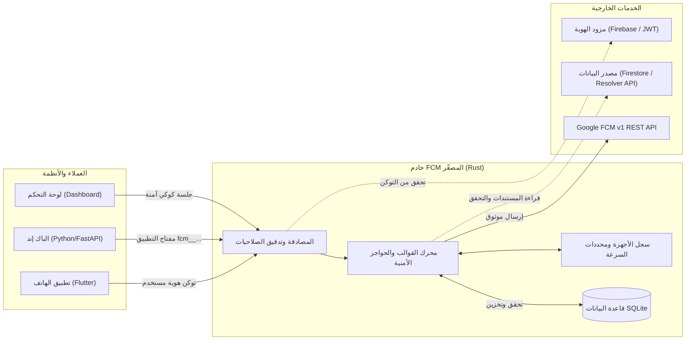

# خادم FCM المصغّر ولوحة التحكم (FCM Microservice & Dashboard)

خادم مصغّر عالي الأداء مبني بلغة **Rust** لإدارة وإرسال إشعارات Firebase Cloud Messaging (FCM)
بسياسات أمان مشددة وقوالب محكمة تمنع التزوير، مع دعم تعدد التطبيقات (Multi-tenant)،
ولوحة تحكم مدمجة (Vue 3)، ودعم مزودات هوية ومصادر بيانات مرنة (Firebase وJWT المستقل).

---

## 1. المعمارية العامة (Architecture)

يعمل الخادم كبوابة وسيطة ذكية وآمنة بين تطبيقات العميل (الهواتف والويب) أو الأنظمة الخلفية وبين خوادم FCM التابعة لـ Google:



---

## 2. المزايا الرئيسية

- **إرسال مبني على القوالب والحواجز الأمنية:** تمنع القوالب تزوير الإشعارات عن طريق سحب البيانات من وثائق النظام الموثوقة والتحقق من ملكية المستخدم لها (`require`).
- **تعدد التطبيقات (Multi-tenant):** إدارة حسابات خدمة Google متعددة لمشاريع مختلفة في خادم واحد عبر مجلد `credentials/` أو رفعها من لوحة التحكم.
- **استقلالية الهوية ومصادر البيانات:** دعم أصيل لـ Firebase Auth وCloud Firestore، إلى جانب دعم توكنات JWT العامة (HS256/RS256) ومصادر البيانات عبر HTTP Resolver API (مثل FastAPI وSupabase).
- **لوحة تحكم متكاملة وآمنة:** واجهة ويب حديثة لإدارة التطبيقات، ومحرر قوالب تفاعلي مع معاينة حية وإرسال تجريبي وسجل إصدارات، ومراجعة حملات الشركات، وحسابات محلية مشفرة بـ `Argon2id` وجلسات آمنة تحمي من هجمات CSRF.
- **سجل الأجهزة ومنع التكرار:** تسجيل tokens الأجهزة مع ربطها بمعرف المستخدم `uid`، وتنظيف تلقائي للأجهزة الملغاة، ومنع تكرار الإرسال `dedupe` بمدة محددة.

---

## 3. البدء السريع (Quick Start)

### 3.1 الإعداد والتثبيت
1. انسخ ملف متغيرات البيئة وعدّل القيم المطلوبة:
   ```bash
   cp .env.example .env
   ```
   *ملاحظة:* تأكد من تعيين `CORS_ALLOWED_ORIGINS` بعنوان لوحة التحكم الصريح.

2. شغّل الخادم باستخدام Docker:
   ```bash
   docker build -t fcm-microservice .
   docker run -d -p 8080:8080 \
     -v $(pwd)/credentials:/app/credentials \
     -v $(pwd)/data.db:/app/data.db \
     --env-file .env \
     fcm-microservice
   ```

### 3.2 إنشاء حساب المالك الأول (Owner)
يُنشأ حساب المالك الأول حصراً عبر سطر الأوامر (CLI):
```bash
docker exec -it <container_id> fcm_microservice create-owner --email admin@example.com
```
سيطبع الأمر كلمة مرور مؤقتة لمرة واحدة. افتح المتصفح على `http://localhost:8080` (أو نطاقك) وسجل الدخول وغير كلمة المرور فوراً.

---

## 4. فهرس الوثائق والمراجع

| المستند | الوصف |
|---|---|
| [جدول الصلاحيات الكامل](docs/permissions.md) | جدول الـ 65 مساراً كاملاً ومن يحق له استدعاء كل مسار. |
| [مرجع القوالب والحواجز](docs/templates-reference.md) | البنية الكاملة لتعريف القوالب، ولغة التعويضات، وقواعد الحواجز، وجدول الرموز التشخيصية. |
| [دليل النشر والتشغيل](docs/deployment.md) | شرح متغيرات البيئة، وإعدادات Nginx/Caddy، والنسخ الاحتياطي لـ SQLite WAL، وخطوات التحديث والتراجع. |
| [دليل الربط: Firebase](docs/integration/firebase.md) | ربط تطبيقات Firebase Auth وCloud Firestore (مثل تطبيق واط). |
| [دليل الربط: JWT + FastAPI](docs/integration/jwt-fastapi.md) | ربط التطبيقات المستقلة مع خادم FastAPI عبر عقد HTTP Resolver. |
| [دليل الربط: Supabase](docs/integration/supabase.md) | ربط Supabase Auth وقواعد PostgreSQL عبر Supabase Edge Functions. |
| [أمثلة استدعاء واجهات البرمجة (cURL)](curl_api.md) | أمثلة عملية جاهزة لاستدعاء مسارات الإرسال والتسجيل للمستخدمين والباك إند. |
| [قائمة الفحص قبل النشر](docs/release-checklist.md) | قائمة تدقيق شاملة للمالك وفريق العمليات قبل النشر للإنتاج وفي حالات الطوارئ. |
| [الدليل المرجعي العام المحدّث](docs.md) | مرجع المعمارية والسياسات العامة للأداة. |
| [إرشادات الوكيل الذكي (.agent.md)](.agent.md) | دليل الصيانة والتطوير للوكلاء الأذكياء ومطوري المشروع. |

---

## 5. تحقق منه

- **فحص بناء وتشغيل الاختبارات الأساسية:** `cargo test` (666 اختباراً ناجحاً).
- **فحص اختبارات واجهة لوحة التحكم:** `cd dashboard && pnpm test` (73 اختباراً ناجحاً).
- **فحص مطابقة جدول الصلاحيات:** `bash scripts/check_permissions_doc.sh` (65 مساراً مطابقاً).
